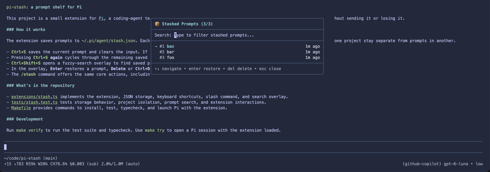

# pi-stash

A [Pi](https://github.com/earendil-works/pi) extension that allows you to stash your currently typed prompt and restore or fuzzy search previous prompts.



## Features

- **`Ctrl+S` (Stash / Restore)**:
  - If the prompt box has text, `Ctrl+S` stashes it to disk and clears the input so you can start a new prompt.
  - If the prompt box is empty, `Ctrl+S` pops and restores the most recent stashed prompt (LIFO order).
  - Pressing `Ctrl+S` consecutively continues cycling through your stashed prompts in LIFO order.
- **`Ctrl+Shift+S` (Fuzzy Search)**:
  - Opens a floating fuzzy search overlay to filter and browse stashed prompts.
  - Press `Enter` to restore and remove the selected prompt.
  - Press `Delete` or `Ctrl+D` to delete an entry directly from the stash.
  - Press `Esc` to cancel.
- **Slash Commands**:
  - `/stash`: Stash current prompt, or open fuzzy search if empty.
  - `/stash pop`: Pop the most recent stashed prompt.
  - `/stash list` or `/stash search`: Open the fuzzy search overlay.
  - `/stash clear`: Clear all stashed prompts for the current directory.
- **Project Isolation**: Stashes are scoped to the working directory (`cwd`) while persisting across sessions in `~/.pi/agent/stash.json`.

## Quick Start

```bash
make install
make try
```

`make try` opens an isolated Pi session with this extension loaded so you can test it directly.

## Development

```bash
make test       # Run vitest test suite
make typecheck  # Typecheck with tsc
make verify     # Run tests and typecheck
```
